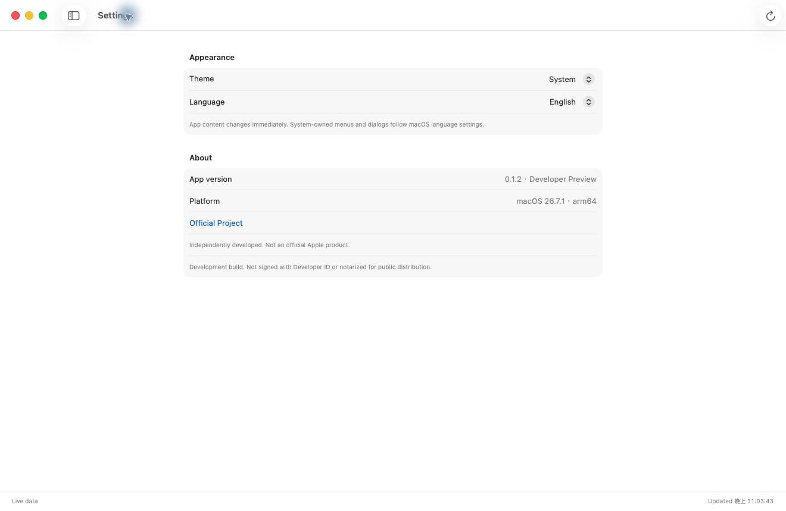

# Container Desk 0.1.2 — Developer Preview

Native SwiftUI manager for **local Apple Container**, built with the macOS 26 SDK. Requires an Apple Silicon Mac running macOS 26 or later. This is an independent application, not an Apple product.

[Download developer preview](https://github.com/eqwgeryfgbdf/container-desk/releases/tag/v0.1.2-preview) · [Public release criteria](docs/PUBLIC_RELEASE_GATE.md) · [Test report template](docs/TEST_REPORT.md)

**Release readiness: NOT READY for public visibility.** The repository stays private until all 14 required acceptance gates pass with evidence and no critical/major defects remain. Automated and smoke-test results below cover only part of that contract. 私人測試中；所有必要驗收項目通過後才符合公開條件。

## Screenshots



Actual macOS 26.7.1 QA-app capture, with the sidebar hidden to omit the local hostname. This shows the current Settings design, not proof that every view or the downloadable DMG has passed acceptance. Creation-form and overview captures are still pending. [Capture provenance and planned walkthrough](docs/MEDIA.md).

## GitHub distribution

The repository contains source, localized resources, build scripts and tests. Downloadable DMGs belong in GitHub Releases, not Git history. Version 0.1.2 should be marked **pre-release** because clean-install/upgrade and final interactive UI acceptance are still pending. Publishing on GitHub does not imply Apple endorsement or notarization.

For a GitHub preview release, run `bash scripts/test.sh` and `bash scripts/package.sh`, then attach the resulting DMG and a SHA-256 checksum file to the corresponding source tag. No Apple Developer account or signing secret is required for this preview workflow. See `RELEASE_NOTES.md` for the release description.

## Install

Open `Container-Desk-0.1.2-arm64-preview.dmg` and drag **Container Desk.app** to **Applications**. This development build is ad hoc signed, without a Developer ID certificate or Apple notarization. This preview can be shared through GitHub Releases without joining Apple Developer Program. GitHub hosting does not change macOS Gatekeeper checks: macOS may prevent this preview from opening after download. Developer ID signing and notarization are an optional future distribution improvement.

The app connects to an existing engine when available. Otherwise open **Container Engine**, check the official release, and choose **Install Apple Container**. macOS performs administrator authorization; the app does not collect an administrator password. The first installation also lets Apple's CLI download its recommended Linux guest kernel from the Kata Containers project. The official engine package is not bundled in this DMG.

## Changes in 0.1.2

- Added explicit migration of the recognized per-user installation to the **same** official release under `/usr/local`, retaining original files and the default user data directory. This requires an idle engine, no existing `/usr/local` installation, Apple-signed source executable, and a matching tested version. Arbitrary custom layouts remain unsupported. Terminal PATH is not changed.
- Installation sequencing now has a separately tested workflow: verify download before stopping, recheck workloads before mutation, recover service on failure, never report failed validation as success. This is service recovery, not binary/data rollback.
- Handle stopped-engine status, reject downgrades, distinguish canceled administrator authorization, and avoid terminating an authorized installer while it is writing files.
- Added `scripts/release.sh`: Developer ID signing, hardened runtime, timestamp, notarization, stapling and mounted-app Gatekeeper assessment. `--check` verifies local prerequisites without uploading. The optional signed/notarized distribution remains unavailable without signing credentials; GitHub preview releases are not blocked.
- Retained 0.1.1 controls: CPU dropdown, synchronized memory slider/integer field and downloaded-image dropdown. No demo mode.

## Acceptance evidence

29 core checks, 13 isolated installer sequencing/recovery scenarios and 179 three-language entries passed. Real Store.create produced a stopped container with the selected local image, 2 CPUs and 768 MiB, then removed the temporary container. Full create/start/logs/stats/stop/delete smoke passed. Real official-release preflight recognized this host's migration and refused it while a workload runs. All 8 existing workload states were preserved.

The official signed package was expanded into the workspace without installation; its CLI hash matches the currently installed custom-layout CLI, the CLI's Apple designated signature verifies, and the extracted CLI reports 1.5.0. This is payload verification, not proof of a clean installation or real migration.

## Included

- Native sidebar, container table, inspector, searchable status filters, grouped forms, toolbar and system appearance.
- Actual local container status, create/start/stop/delete, logs, CPU delta samples and memory usage. Published ports default to loopback. New containers start stopped.
- Actual Mac specifications: model, chip, CPU cores, physical memory, macOS/build, architecture and home volume capacity/free space. Unknown values remain unavailable. No hardware serial number or UUID is retained.
- Images, networks and volumes: read-only inventory.
- English base, Simplified Chinese and Traditional Chinese, with immediate app-content language switching. System-owned menus follow macOS settings.
- All displayed container and host data is live; demo mode and sample data have been removed.
- Official stable release checks. Signed package URL, size, SHA-256 digest, Apple Containerization installer identity and macOS package assessment are checked before installation.
- Manual updates and opt-in automatic updates while the app is open; automatic checking defaults on, installation defaults off. Installs require a tested release and no running containers; system authorization still applies.

## Preview limits

Only Container **1.5.0** is currently marked compatible. Newer releases are displayed but installation is deferred until tested; automatic mode does not imply unconditional future-version support. Custom files are not overwritten. The recognized `~/.local/bin/container` wrapper can explicitly migrate to the same official version when idle; the original installation is preserved. Other custom layouts still use their original installation method. There is no privileged background helper, closed-app scheduler, remote host management, interactive terminal, full resource editor, skip-version preference or separate guest-kernel updater yet.

Live create/start/logs/stats/stop/delete smoke testing passed using one disposable container, with all 8 existing container states unchanged. 29 automated policy/parser/process/hardware checks and 179 × 3 localization entries passed. The official 1.5.0 package's digest and Apple signature were verified. Fresh installation and upgrade were **not** executed end to end on this working host. Final hardware-page/form/dark-mode/multi-size visual review remains blocked: UI automation cannot retrieve the app window, including a separate QA bundle. Do not treat this preview as a signed production release or full acceptance of every design-spec item.

## Build and test

Install Apple's Xcode 26 or Command Line Tools 26 with a macOS 26 SDK, plus Python 3. There are no third-party Swift package dependencies.

```sh
bash scripts/test.sh
bash scripts/build.sh
bash scripts/package.sh
```

The app bundle is written to `../work/build/Container Desk.app`; DMG to `../outputs`. `Package.swift` supports source browsing in Xcode, but use the build script for the complete `.app` with Info.plist and localized resources. `Resources/Localizable.xcstrings` is generated from `scripts/make_catalog.py`; the bundler converts its translations into `.strings` resources. Regenerate it after changing localization entries.

To rerun the opt-in integration smoke test, compile `Sources/Models.swift`, `Sources/ProcessRunner.swift`, and `Tests/IntegrationSmoke.swift` together, then pass the CLI path and an **existing local image with `/bin/sh`**. This creates and removes only a UUID-named test container.

For an optional Developer ID signed and notarized release, set `SIGNING_IDENTITY` to an installed Developer ID Application identity and `NOTARY_PROFILE` to an existing notarytool Keychain profile, then run `bash scripts/release.sh`. Do not put passwords, private keys or API secrets in source files. The script only reports success after notarization acceptance, stapling, DMG verification and Gatekeeper assessment. Complete the pending clean-install, update, accessibility and visual acceptance checks before distributing.

## Official references

- Apple Container: https://github.com/apple/container
- Releases: https://github.com/apple/container/releases
- macOS design: https://developer.apple.com/design/human-interface-guidelines/designing-for-macos
- New design: https://developer.apple.com/documentation/TechnologyOverviews/adopting-liquid-glass
- Distribution: https://developer.apple.com/documentation/security/notarizing-macos-software-before-distribution
