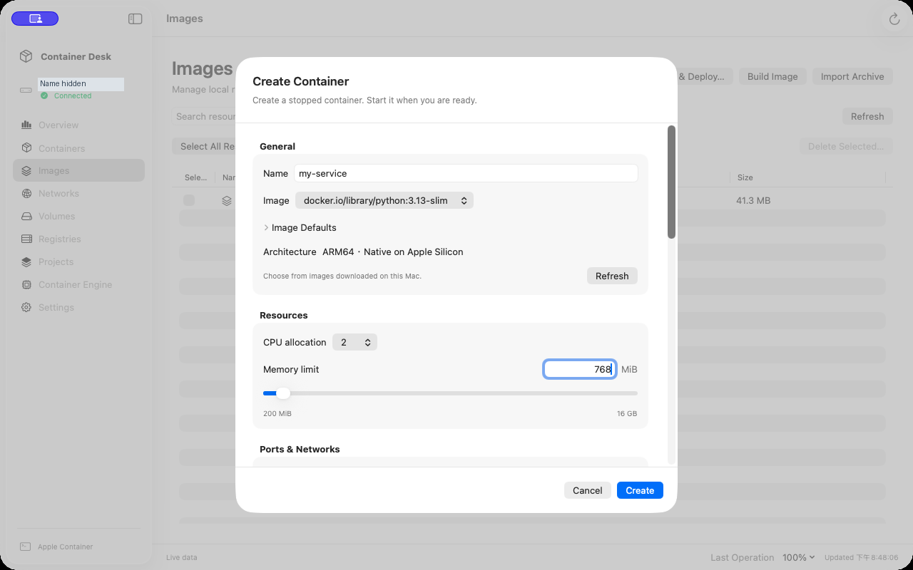

# Container Desk 0.3.0 — 预览版

[English](README.md) · [中文（繁體）](README.zh-Hant.md) · [中文（简体）](README.zh-Hans.md)

原生 SwiftUI **本机 Apple Container** 管理工具，支持 Apple Silicon 与 macOS 26 以上。独立开发，并非 Apple 产品；已测试引擎 **1.5.0**。

[下载 0.3.0 预览版 DMG](https://github.com/eqwgeryfgbdf/container-desk/releases/download/v0.3.0-preview/Container-Desk-0.3.0-arm64-preview.dmg) · [版本说明](https://github.com/eqwgeryfgbdf/container-desk/releases/tag/v0.3.0-preview) · [Hugging Face 与本地 AI 教程](docs/AI_QUICK_START.zh-Hans.md) · [上一版 0.2.0](https://github.com/eqwgeryfgbdf/container-desk/releases/tag/v0.2.0)

**本次新增：** 搜索 Hugging Face、筛选单文件 GGUF 量化版本、查看容量／授权／估计内存，下载时固定版本并验证 SHA-256。通过 Apple Container 运行本地 llama.cpp，测试模型与 MCP 兼容性，确认工具调用后才执行。镜像更新支持经确认的容器替换、健康检查与恢复。[AI 验证记录](docs/AI_VALIDATION.md) · [镜像更新教程](docs/IMAGE_UPDATES.md)。

仅在开发者自己的 M4 Mac mini（16 GiB、macOS 26.7.1）测试，第二台 Mac 测试仍延后。本预览版**只有 ad hoc 签名，没有 Developer ID 或 Apple 公证**。Release 手动附件只有 DMG；三语教程、测试与 Apache-2.0 源码放在仓库，GitHub 另会自动生成源码归档。

## 五分钟尝试 Hugging Face

1. 下载 DMG，将 **Container Desk.app** 拖到“应用程序”后打开。macOS 阻止时请按[单个 App 安装教程](docs/QUICK_START.zh-Hans.md)处理，不要全局关闭 Gatekeeper。
2. 到“容器引擎”启动或安装 Apple 官方引擎；模型与 llama.cpp 服务器镜像另外下载。
3. 打开“**本地 AI → 搜索 Hugging Face**”，点击 `SmolLM2-135M-Instruct`，选择 `bartowski/SmolLM2-135M-Instruct-GGUF`。
4. 在文件筛选中输入 `Q4_K_M`，选择 `SmolLM2-135M-Instruct-Q4_K_M.gguf`（约 105 MB），查看授权后点击“**选择并下载**”。
5. 轻量文字测试可用 2 CPU、1 GiB、1,024 上下文，再创建并启动 llama.cpp。使用 MCP 前先点击“测试模型与工具调用”；此小模型已通过文字推理，但未通过工具调用，出现兼容性提示是预期结果。[完整教程及故障排查](docs/AI_QUICK_START.zh-Hans.md)。

GGUF 格式不保证引擎或工具调用兼容；Linux VM 内使用 CPU，没有 Metal。若只想快速测试容器，可下载并检查固定版本的脚本后执行：

```sh
curl -fL https://raw.githubusercontent.com/eqwgeryfgbdf/container-desk/v0.3.0-preview/scripts/quick-test.sh -o quick-test.sh
bash quick-test.sh --check
bash quick-test.sh --run
```

`--check` 为只读；`--run` 创建、验证并清除自己的本地 HTTP 测试容器，不会安装 AI 模型。不需要额外下载 Release ZIP。

## 常用界面与操作视频

### 总览


### 容器管理


### 创建容器



[观看实机操作视频](https://github.com/eqwgeryfgbdf/container-desk/releases/download/v0.2.0/Container-Desk-Overview-zh-Hant.mp4)（繁体字幕）。截图与视频均为 **0.2.0 在开发者自己的 Mac** 上操作真实测试容器，主机名已遮挡，没有模拟数据；可能显示 macOS 录屏指示。媒体不代表全新安装／升级验收。[来源说明](docs/MEDIA.md)。

## 0.2.0 包含的功能

- **安全复制容器：** 从实际配置创建独立副本，清除端口；环境变量与挂载需选择加入，挂载默认只读，可写共享需源容器已停止。保留原容器。
- **磁盘用量与清理：** 读取真实用量，逐项确认可删除的镜像／网络／卷，不做全局 prune。
- **镜像默认信息与仓库浏览：** 创建前查看启动命令、用户、工作目录与声明端口；浏览 HTTPS Registry V2 项目／标签后部署。目录浏览采用独立临时 Basic 认证，不保证支持所有 Bearer 认证服务。
- **容器管理：** 创建、启动、停止、重启、检查与删除；批量选择和操作确认；CPU 下拉菜单、内存滑块／数字输入、已下载镜像选择。新容器先创建为停止状态。
- **完整信息：** 双击展开、实时 CPU／内存／进程／网络摘要、会话图表、日志搜索和导出、可点击的 TCP 地址与复制网址。不模拟缺失数据；网络数字为累计流量。
- **镜像与部署：** Docker Hub 搜索、仓库镜像引用、架构检查、下载并配置、ARM64 或 AMD64／Rosetta 选择、Dockerfile 构建、标签／删除、OCI 导入导出。切换架构不等于转换二进制文件。
- **文件与快照：** 浏览容器文件、不覆盖的传输、将容器保存为镜像。快照不包含挂载数据，环境变量需要主动选择纳入。[范围说明](docs/CONTAINER_SNAPSHOTS.md)。
- **仓库、网络与存储卷：** 登录／退出、推送镜像、搜索、创建、引用保护与批量删除确认。[使用说明](docs/COMPOSE_AND_FILES.md)。
- **项目与 Docker 迁移：** 检查并导入受支持的 Compose 配置，将 Docker 项目转换为独立配置文件，可选用已安装的官方 Compose CLI 解析覆盖配置，再启动／停止／移除服务。不支持的字段会阻止导入；Docker 本地镜像和存储卷数据需要单独迁移。[转换教程](docs/DOCKER_CONVERSION.md)。
- **原生界面：** 保存侧栏顺序、80–150% 内容缩放（⌘+、⌘−、⌘0）、遵循减少动态效果、真实主机规格、英文／繁中／简中，没有演示模式。
- **引擎：** 官方来源安装、手动及选择启用的自动更新，含工作负载检查。安装仅限已测试版本并需要系统授权；App 打开时才进行更新。

## 测试范围

自动化覆盖容器生命周期、数据保留、文件、镜像、项目与转换、仓库失败／本地推送及资源保护。新增容器复制、镜像信息、仓库目录与三项中度安全修复回归测试。完整结果、跳过项目及长时间运行数据见[本版验证记录](docs/RELEASE_0.2.0_VALIDATION.md)；跳过不代表通过。

仅在自己的设备上测试。全新引擎安装、真实旧版升级、外部私有 HTTPS 仓库成功流程及完整 VoiceOver 人工验收仍未验证。AI 功能见开发预览版教程；Docker 数据与本地镜像仍需单独迁移，尚无自动重启监督、切换／回滚、远程主机、内嵌终端或 App 关闭后更新。[功能状态](docs/FEATURE_ROADMAP.md) · [反馈模板](docs/TEST_REPORT.md)。

## 源码、打包与许可

后续 GitHub Releases 仅附 `.dmg` 安装文件。源码使用 GitHub 为 release tag 自动提供的下载，采用 **Apache-2.0** 许可。教程、测试脚本与视频放在仓库或文档；构建 manifest 和校验码仅保留于本地 `../work/release-metadata`，不再作为附件上传。历史附件保持原状。

开发者需要 Command Line Tools／Xcode 26 和 Python 3：

```sh
bash scripts/test.sh
bash scripts/build.sh
# 先提交所有源码变更，再生成同版产物：
bash scripts/package.sh ../outputs
```

打包要求干净的 Git 工作目录，Release 标签必须对应 manifest 的提交。可选的 Developer ID／公证流程已准备，本次公开版仅有 ad hoc 签名。[Apache-2.0 许可](LICENSE) · [公开门槛](docs/PUBLIC_RELEASE_GATE.md)。

## 官方依赖

[Apple Container](https://github.com/apple/container) 为独立依赖，有自己的许可。官方安装包按需下载，未内嵌在 App 中。

### 更新镜像与容器

选取镜像 → **更新 → 检查并下载最新镜像**，再选 **将镜像套用至容器…**。验证包含摘要、运行状态及选填的 HTTP 健康检查；保留原容器供恢复。替代容器的名称／IP 会改变，挂载资料不会回滚。操作界面提供简体中文说明；详细限制与脚本测试见[更新指南（英文）](docs/IMAGE_UPDATES.md)。此功能目前位于开发版本。
