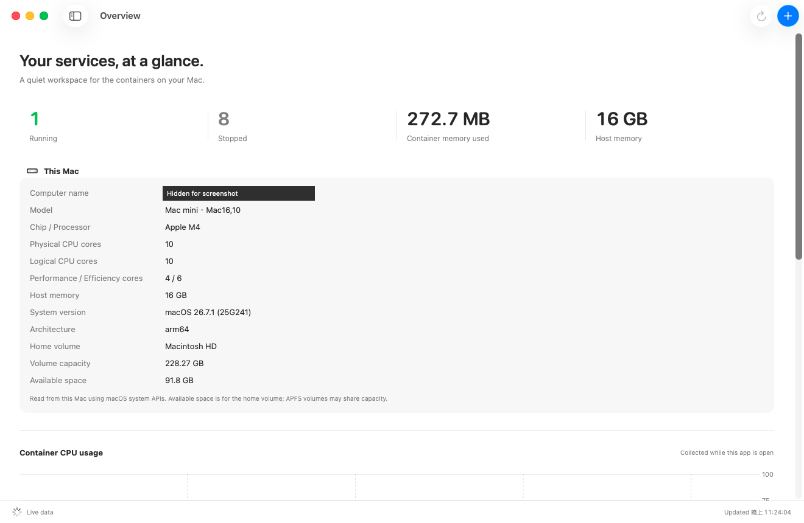
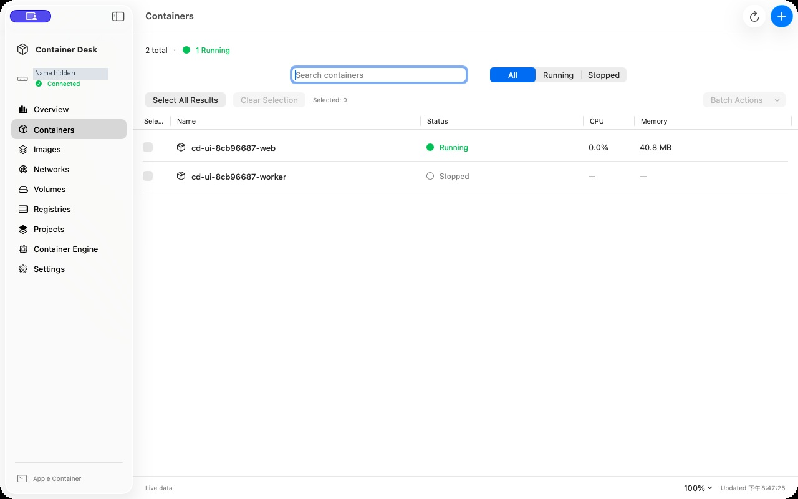

# Container Desk 0.1.2 — 开发预览版

[English](README.md) · [中文（繁體）](README.zh-Hant.md) · **中文（简体）**

使用 macOS 26 SDK 构建的原生 SwiftUI **本机 Apple Container** 管理工具。需要搭载 Apple Silicon、运行 macOS 26 或更新版本的 Mac。本项目独立开发，并非 Apple 产品。

[下载开发预览版](https://github.com/eqwgeryfgbdf/container-desk/releases/tag/v0.1.2-preview) · [公开验收标准（英文）](docs/PUBLIC_RELEASE_GATE.md) · [测试报告模板（英文）](docs/TEST_REPORT.md)

**公开状态：尚未达标。** 仓库保持私有，直到全部 14 项必要验收通过且附有证据，并且没有未解决的严重或重大问题。以下自动化与基本流程测试仅覆盖部分验收要求。

## 界面截图

### 概览



### 容器管理



以上为 macOS 26.7.1 上 0.1.2 QA 应用的实际英文界面。概览仅明确遮盖计算机名称；管理页面筛选出真实的临时测试容器，截图后已删除。硬件与容器数值并非模拟数据。截图不代表下载版 DMG 已通过验收，也不代表完整验收完成。[截图来源说明（英文）](docs/MEDIA.md)。

## GitHub 发布

仓库包含源代码、本地化资源、构建脚本与测试。DMG 下载文件放在 GitHub Releases，不纳入 Git 历史。0.1.2 的全新安装、升级与完整界面交互验收仍待完成，因此应标记为 **Pre-release（预览版）**。在 GitHub 发布不代表获得 Apple 认可或公证。

预览版打包先运行 `bash scripts/test.sh` 与 `bash scripts/package.sh`，再将生成的 DMG、同版本源代码 ZIP、版本清单与 SHA-256 校验和一起附加到对应源代码标签的 Release。此流程不需要 Apple Developer 账号或签名密钥。三语发布说明见 [RELEASE_NOTES.md](RELEASE_NOTES.md)。

新的打包流程会生成配对的源代码 ZIP、记录源代码提交的清单与 SHA-256 校验和。打包要求 Git 工作目录没有未提交修改；构建期间如果源代码改变，就会拒绝生成配对结果。上传时应提供完整组合，Release 标签必须指向清单记录的提交。源代码 ZIP 包含 Apache-2.0 许可证、程序、资源、构建脚本与测试，不含 Git 内部数据及已忽略的构建产物。

| 发布方式 | 应用 | 同版本源代码 |
| --- | --- | --- |
| 开发预览版 | `Container-Desk-VERSION-arm64-preview.dmg` | `Container-Desk-VERSION-preview-source.zip` |
| 签名与公证发布流程 | `Container-Desk-VERSION-arm64.dmg` | `Container-Desk-VERSION-source.zip` |

签名流程已准备，但尚未生成正式版本：目前没有 Developer ID 证书，必要验收也尚未完成。文件名或打包成功本身不代表稳定版本。现有 0.1.2 Release 附件保持原样；配对产物流程适用于新打包的文件。

## 许可证

Container Desk 采用 [Apache-2.0](LICENSE)。Apple Container 是独立依赖项，适用其自身许可证；需要时才下载官方安装程序，本项目不内置该软件包。许可证完整条文以英文 LICENSE 为准。

## 安装

打开 `Container-Desk-0.1.2-arm64-preview.dmg`，将 **Container Desk.app** 拖到 **Applications（应用程序）**。此开发版使用 ad hoc 签名，没有 Developer ID 证书或 Apple 公证。不加入 Apple Developer Program 仍可通过 GitHub Releases 分享预览版，但 GitHub 不会改变 macOS Gatekeeper 检查：下载后可能无法打开。Developer ID 签名与公证可作为后续发布改进。

应用会连接到现有引擎。如果尚未安装，打开 **Container Engine（容器引擎）**，检查官方版本，再选择 **Install Apple Container（安装 Apple Container）**。管理员授权由 macOS 处理，应用不收集管理员密码。首次安装也会由 Apple CLI 下载其推荐的 Kata Containers Linux 客体内核。此 DMG 不内置官方引擎软件包。

## 0.1.2 更新内容

- 新增明确的迁移流程：将已识别的个人用户安装转换为 `/usr/local` 下的**相同官方版本**，保留原始文件与默认用户数据目录。需要引擎空闲、`/usr/local` 尚未安装、源可执行文件具有 Apple 签名，且版本已通过兼容性验证。不支持任意自定义配置，也不修改终端 PATH。
- 安装顺序已独立测试：停止引擎前先验证下载，变更前再次检查工作负载，失败时尝试恢复服务，不将验证失败显示为成功。服务恢复不等于可执行文件或数据回滚到旧版本。
- 处理引擎已停止的状态、拒绝降级、区分管理员取消授权，避免在已授权安装程序写入文件时将其终止。
- 新增 `scripts/release.sh`，包含 Developer ID 签名、强化运行时、时间戳、公证、公证票据附加及挂载后的 Gatekeeper 检查。`--check` 仅检查本机条件，不上传。没有签名证书时无法生成签名与公证版本，但仍可创建 GitHub 预览版。
- 保留 0.1.1 控件：CPU 下拉菜单、同步的内存滑块与整数输入框、已下载镜像下拉菜单。已移除演示模式。

## 验收证据

已通过 29 项核心检查、13 项隔离的安装顺序与恢复场景，以及 179 组三语文案检查。实际 `Store.create` 使用选定的本机镜像、2 个 CPU 与 768 MiB 内存创建停止状态的容器，随后删除。创建、启动、日志、资源统计、停止及删除的基本流程已通过。真实官方版本预检查识别出本机迁移需求，并在有工作负载运行时拒绝执行。现有 8 个工作负载状态均保持不变。

官方签名软件包只在工作目录解包，没有执行系统安装。包内 CLI 哈希与当前自定义配置中的 CLI 相同，Apple 指定签名验证通过，解包的 CLI 报告版本 1.5.0。这是软件包内容验证，不代表全新安装或实际迁移已通过。

## 功能

当前源代码新增容器文件浏览、拒绝覆盖的上传下载、Registry 登录／退出和镜像推送，以及可预览确认的 Compose 项目导入、启动、停止和移除。Compose 支持明确列出的子集，包括依赖服务就绪检查、保留命名卷和托管的服务名称映射；不支持的字段会直接拒绝。[操作与兼容范围](docs/COMPOSE_AND_FILES.md)。现有下载文件尚未包含这些功能。

当前源代码也加入「**转换 Docker 项目…**」：选择 Compose、Dockerfile 或项目文件夹，检查兼容性后另存配置并导入。不支持的需求会阻止转换；将自动重启改为手动管理须明确勾选。保留原文件与 Docker 工作负载；卷数据及仅存在 Docker 的本地镜像需要另外迁移。[转换指南与限制](docs/DOCKER_CONVERSION.md)。现有下载文件保持原样。

Docker 转换现在可使用已安装的官方 Compose CLI 解析覆盖文件、YAML 模板与环境文件，并支持多网络／别名、构建参数及目标。**镜像 → 快速部署…** 可粘贴 Docker Hub 链接或 Registry 镜像名称，验证 arm64 镜像后进入配置。完整保留数据的无痛转移仍未完成，详见[转移验收条件](docs/MIGRATION_ACCEPTANCE.md)。

当前源代码新增镜像下载／构建／标签／删除与 OCI 归档导入导出、网络／存储卷创建与受保护删除、容器重启、JSON 配置检查及外部终端入口。创建容器可选择网络／存储卷并设置高级命令。长时间操作有实时输出，可在后台继续或取消；同时修复了内存滑块导致的窗口卡住问题。详见[功能状态与后续基本功能](docs/FEATURE_ROADMAP.md)。这些变更**尚未包含在现有 `v0.1.2-preview` 下载文件中**。

当前源代码也加入多选容器批量操作（先确认清单）、多组 TCP／UDP 端口与文件夹／存储卷挂载，以及可搜索、切换应用程序／启动来源、复制和导出的日志快照。批量任务会逐项报告结果，拒绝状态已改变或不适用的操作。现有下载文件尚未包含这些新增功能。

页面与信息／日志标签页采用短暂淡入淡出；展开详情及缩放使用可中断的平滑过渡。自定义动画遵循 macOS「减少动态效果」，定期指标／日志更新不触发动画。这些源代码更新尚未包含在现有 `v0.1.2-preview` 下载文件中。

当前源代码支持主内容区 80%～150% 缩放：**⌘+**（也支持 **⌘=**）放大、**⌘−** 缩小、**⌘0** 还原到 100%。也可使用「显示」菜单或右下角比例菜单；应用会记住比例，较窄的窗口可水平滚动。原生侧边栏、工具栏及对话框保持标准尺寸。现有 `v0.1.2-preview` 下载文件尚未包含此功能。

当前源代码的展开页已加入实时 CPU、内存、进程与网络摘要、单个容器趋势图（本次 App 会话最近 120 次实际采样）、端口／配置／挂载分区及全宽日志视图。缺少的数据不补为零；网络数值为累计流量而非带宽。现有 `v0.1.2-preview` 下载文件尚未包含此仪表板。

当前源代码支持双击容器行，或从右键菜单选择「展开容器详情」，在整个窗口内容区显示信息与日志。点击「返回容器列表」或按 Esc 可恢复列表、选中项与原先的侧边栏显示状态。现有 `v0.1.2-preview` 下载文件尚未包含此功能。

当前源代码新增可点击的 TCP 端口映射，在默认浏览器打开主机端网址，并提供右键「复制网址」。默认使用 HTTP；容器端 443 使用 HTTPS。绑定所有接口的地址会转换为本机回环地址，UDP 保持文本。服务本身须支持 HTTP／HTTPS。现有 `v0.1.2-preview` 下载文件尚未包含此功能。

- 原生侧边栏、容器表格、详情面板、搜索与状态筛选、分组表单、工具栏及系统外观。
- 真实本机容器状态、创建／启动／停止／删除、日志、CPU 差值采样与内存用量。发布的端口默认仅绑定本机回环地址；新容器创建后保持停止。
- 实际 Mac 配置：机型、芯片、CPU 核心、物理内存、macOS 与构建版本、架构，以及主目录所在磁盘容量与可用空间。无法获取的值保持不可用，不保留硬件序列号或 UUID。
- 镜像、网络与存储卷：可搜索的管理列表、配置检查与删除前引用检查（当前源代码）。
- 以英文为基础，提供简体中文及繁体中文；切换后即时更新应用内容。系统管理的菜单遵循 macOS 设置。
- 主机及容器数据均来自实际环境，已移除演示模式与示例数据。
- 检查官方稳定版；安装前验证签名软件包 URL、大小、SHA-256、Apple Containerization 安装程序身份与 macOS 软件包评估结果。
- 应用打开时提供手动更新及自行启用的自动更新。默认开启自动检查、关闭自动安装。安装要求版本已验证且没有运行中的容器，仍需系统授权。

## 预览版限制

目前仅将 Container **1.5.0** 列为兼容版本。较新版本会显示信息，但通过测试前不安装；自动模式不代表无条件支持未来版本。不覆盖自定义文件。已识别的 `~/.local/bin/container` 包装脚本可在空闲时明确迁移到相同官方版本，保留原安装。其他自定义配置仍须使用原安装方式。目前没有特权后台辅助程序、关闭应用后的调度、远程主机管理、内嵌终端、完整资源编辑器、跳过版本偏好或独立客体内核更新器。

当前源代码通过 48 项核心检查、35 项管理功能检查、34 项工作流程检查、13 项模拟安装场景及 483 组三语文案检查。实际资源创建／删除保护、容器重启与卷数据保留、镜像构建／下载／归档往返，以及原生界面的标签和创建容器流程均通过；原有 8 个容器状态不变。UI-001 已定位为 macOS 26 离散滑块刻度问题并修复，原生布局测试覆盖 16 GiB 与 1 TiB 主机范围。完整表单、无障碍、多尺寸和第二台 Mac 验收仍待完成；全新安装和真实升级仍**尚未**端到端验证。现有下载文件保留此前限制，详见[测试记录](docs/TEST_REPORT.md)。

## 构建与测试

构建现使用 Swift Package Manager 和固定版本 Yams 6.2.2，首次构建会下载此依赖包。必要许可声明随 App 和 [THIRD_PARTY_NOTICES.md](THIRD_PARTY_NOTICES.md) 一并提供。

安装 Apple Xcode 26 或 Command Line Tools 26（含 macOS 26 SDK），以及 Python 3。本项目没有第三方 Swift 软件包依赖项。

```sh
bash scripts/test.sh
bash scripts/build.sh
bash scripts/package.sh
```

应用输出到 `../work/build/Container Desk.app`，DMG 输出到 `../outputs`。`Package.swift` 可供 Xcode 浏览源代码；完整 `.app`（含 Info.plist 与本地化资源）请使用构建脚本。`Resources/Localizable.xcstrings` 由 `scripts/make_catalog.py` 生成，打包时转换为 `.strings` 资源；修改翻译后须重新生成。

如需自行重新运行集成基本流程测试，一起编译 `Sources/Models.swift`、`Sources/ProcessRunner.swift` 与 `Tests/IntegrationSmoke.swift`，再传入 CLI 路径及**现有且含 `/bin/sh` 的本机镜像**。测试只创建及删除 UUID 命名的测试容器。

如需 Developer ID 签名与公证版本，将 `SIGNING_IDENTITY` 设为已安装的 Developer ID Application 证书身份，并将 `NOTARY_PROFILE` 设为现有的 notarytool 钥匙串配置名称，再运行 `bash scripts/release.sh`。不要把密码、私钥或 API 密钥写入源代码。脚本仅在公证通过、附加票据、DMG 验证及 Gatekeeper 检查成功后报告完成。发布前仍须完成全新安装、更新、无障碍与视觉验收。

## 引用

- [Apple Container](https://github.com/apple/container)
